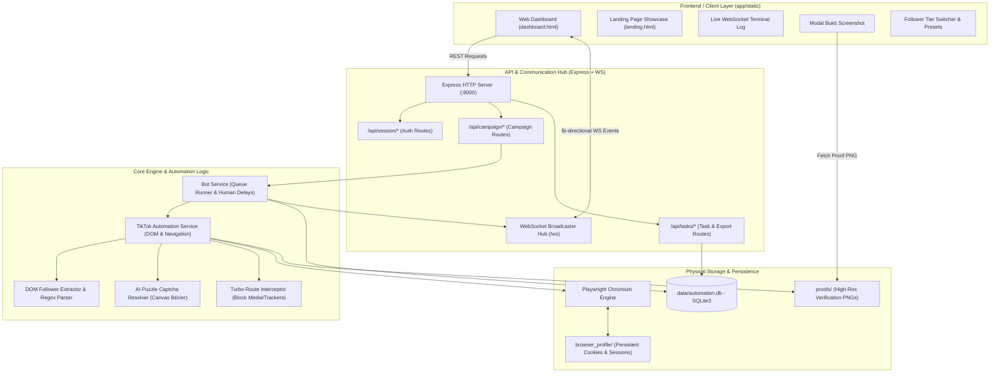
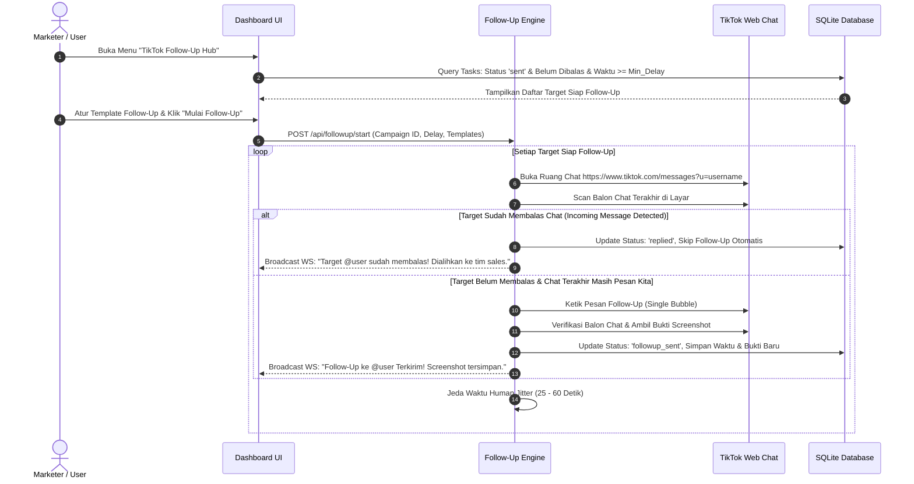

# 🚀 OmniReach (TikReach v2.0) - Enterprise TikTok Outreach & Automation Platform
> **Master Documentation, Architectural Specification, UI Redesign Blueprint & Feature Roadmap**

[](https://nodejs.org/)
[](https://expressjs.com/)
[](https://playwright.dev/)
[](https://www.sqlite.org/)
[](https://github.com/websockets/ws)
[](https://playwright.dev/)
[](app/static/)

---

## 📖 Ringkasan Eksekutif & Tujuan Dokumen

**OmniReach (TikReach v2.0)** adalah platform otomasi outreach, direct message (DM), dan talent scouting TikTok berskala enterprise yang dirancang khusus untuk agensi pemasaran (*influencer marketing agency*), brand owner, affiliate manager, serta tim talent acquisition.

Dokumen ini disusun sebagai **Single Source of Truth (SSOT)** dan cetak biru menyeluruh (*master blueprint*) yang mencakup:
1. **Arsitektur Teknis Lengkap:** Backend Express, antrean orkestrasi Playwright, WebSocket telemetri, skema database SQLite, dan algoritma anti-deteksi bot.
2. **Cetak Biru Redesain Antarmuka (UI Redesign Blueprint):** Dokumentasi detail semua elemen DOM, ID, kelas CSS, alur navigasi, dan fungsi JavaScript frontend agar siap dirombak menggunakan tool perancang modern (seperti **Google Stitch MCP**, Figma, atau Tailwind UI) tanpa merusak integrasi logika aplikasi.
3. **Spesifikasi Modul Follow-Up Automation (TikTok):** Rancangan fitur lanjutan untuk mengidentifikasi kreator yang belum merespons pesan pertama, memeriksa riwayat obrolan secara visual, dan mengirimkan pesan berantai berjadwal (*sequential follow-up campaign*).
4. **Logika Dynamic Follower Tiering:** Sistem cerdas pendeteksi jumlah follower kreator target secara realtime di halaman profil untuk menentukan copywriting penawaran yang paling relevan (Tier 200+, Tier 1.000+, dan Fallback Cadangan).

---

## 📑 Daftar Isi

- [1. Arsitektur Sistem & Diagram Alur Data](#1-arsitektur-sistem--diagram-alur-data)
- [2. Fitur Utama & Inovasi Teknologi Saat Ini](#2-fitur-utama--inovasi-teknologi-saat-ini)
- [3. Logika Dynamic Follower Tiering & AI Approaching](#3-logika-dynamic-follower-tiering--ai-approaching)
- [4. Spesifikasi Fitur Baru: TikTok Follow-Up Automation Engine](#4-spesifikasi-fitur-baru-tiktok-follow-up-automation-engine)
- [5. Cetak Biru Lengkap Redesain Antarmuka (UI/UX Blueprint)](#5-cetak-biru-lengkap-redesain-antarmuka-uiux-blueprint)
- [6. Struktur Lengkap Repositori & Direktori](#6-struktur-lengkap-repositori--direktori)
- [7. Spesifikasi Skema Database Relasional (SQLite)](#7-spesifikasi-skema-database-relasional-sqlite)
- [8. Dokumentasi Lengkap REST API Endpoints](#8-dokumentasi-lengkap-rest-api-endpoints)
- [9. Spesifikasi Protokol WebSocket Telemetry](#9-spesifikasi-protokol-websocket-telemetry)
- [10. Kebijakan Anti-Deteksi & Mitigasi Limit Algoritma TikTok](#10-kebijakan-anti-deteksi--mitigasi-limit-algoritma-tiktok)
- [11. Panduan Instalasi & Eksekusi Cepat](#11-panduan-instalasi--eksekusi-cepat)

---

## 1. Arsitektur Sistem & Diagram Alur Data

Aplikasi dibangun dengan prinsip **Clean Architecture & Decoupled Modular Services**, memisahkan presentasi UI, kontrol API, antrean orkestrasi bot, serta lapisan persistensi database.



---

## 2. Fitur Utama & Inovasi Teknologi Saat Ini

### 🛡️ 1. Persistent Browser Context (Login Sekali Selamanya)
* Menggunakan `launchPersistentBrowserContext` Playwright dengan direktori penyimpanan profil fisik di `browser_profile/`.
* Menyimpan sesi login, token otentikasi, IndexedDB, dan cache peramban Chromium secara permanen.
* Dilengkapi utilitas otomatis `cleanLocks()` yang membersihkan `SingletonLock` ketika browser tertutup secara mendadak atau terjadi kegagalan proses.

### 🕵️ 2. Anti-Detection Stealth Hardening
* Menginjeksi skrip runtime sebelum halaman dimuat:
  * `navigator.webdriver = undefined`
  * Mocking objek `window.chrome` (runtime, app, csi, loadTimes).
* Menghilangkan flag otomatisasi berbahaya Playwright dengan parameter `--disable-blink-features=AutomationControlled` dan `ignoreDefaultArgs: ['--enable-automation']`.
* Memastikan koneksi WebSocket internal TikTok Web (`/ws`) tidak memblokir pengiriman direct message.

### ⚡ 3. Turbo Route Interception (Hemat RAM & Kuota 70%)
* Melakukan intersepsi pada level jaringan peramban (*network request route interception*).
* Memblokir otomatis pengunduhan media berat yang tidak diperlukan untuk pengiriman DM:
  * Berkas video feed TikTok (`.mp4`, `.webm`, `.m3u8`).
  * Ribuan baris pelacak telemetri analitik (*mon.tiktok.com*, *byteoversea.com*, *tiktokv.com*).
* Halaman profil target terbuka **3x hingga 5x lebih cepat** dan konsumsi RAM berkurang hingga 70%.

### 💬 4. Single-Bubble Multi-Line Message Delivery
* **Kebijakan Ketat TikTok:** Pada akun yang belum saling mengikuti (*non-mutual*), TikTok hanya mengizinkan pengiriman **1 balon pesan obrolan**. Jika pesan multi-baris dikirimkan satu per satu menggunakan tombol Enter biasa, pesan baris kedua akan langsung ditolak sistem dengan galat *"Pesan dibatasi demi keamanan"*.
* **Solusi Atomik:** OmniReach menginjeksi seluruh baris pesan (termasuk emoji, tanda kurung, dan enter `\n`) secara utuh menggunakan `page.keyboard.insertText(message)`. Pesan terkirim sempurna dalam **satu balon chat tunggal**.

### 📸 5. Proof-of-Work Verification (Tangkapan Layar Resolusi Tinggi)
* Sistem tidak mengandalkan asumsi waktu (*arbitrary delay*).
* Bot memindai area obrolan aktif ($x \ge 280\text{px}$) hingga 20 detik untuk mengonfirmasi bahwa balon teks obrolan **secara nyata muncul di layar obrolan**.
* Setelah balon pesan terkonfirmasi muncul, sistem mengambil screenshot layar resolusi tinggi dan menyimpannya secara otomatis ke:
  `proofs/proof_{taskId}_{username}_{timestamp}.png`.
* Jika pesan gagal muncul di layar (misalnya dibatasi atau akun target privat), screenshot tidak disimpan dan tugas ditandai secara jujur sebagai `failed` atau `dm_closed`.

### 🧩 6. AI Puzzle Captcha Auto-Solver
* Modul `captcha.service.js` mendeteksi tantangan puzzle slider TikTok.
* Membaca celah puzzle melalui manipulasi Canvas in-memory dan menggeser slider menggunakan kurva interpolasi pergerakan tangan manusia (*Cubic Bézier easing curve with micro-jitter & overshoot correction*).

### 🔄 7. Auto-Reset Sequence Penomoran Proof
* Setiap kali antrean kampanye selesai atau dibersihkan dari antrean kosong, sistem mereset `sqlite_sequence` tabel `outreach_tasks` sehingga penomoran tugas dan berkas screenshot selalu rapi dimulai dari angka 1 (`proof_1_...`).

---

## 3. Logika Dynamic Follower Tiering & AI Approaching

Fitur ini memungkinkan pengguna untuk membedakan materi penawaran kolaborasi (*value proposition*) secara dinamis berdasarkan skala jangkauan kreator target.

### 🎯 Pembagian Tingkatan (Tiers) & Preset Copywriting

#### 1. 🚀 Tier 1.000+ Followers (Kreator Mapan / Makro Pemula)
* **Kriteria:** Akun dengan jumlah pengikut $\ge 1.000$.
* **Value Hook:** Penawaran komisi penjualan 10–15% ditambah **Hadiah Headset Eksklusif** (khusus pengguna iPhone).
* **Preset Template:**
  ```text
  Halo Kak! 👋 Aku Zakaria dari tim Business Development PACC.
  Aku lihat konten kakak punya engagement yang bagus dan audiens lokal yang solid. Kami tertarik ngajak Kakak kolaborasi sebagai Shopee Affiliate PACC karena konten Kakak relevan dengan produk kami.
  🎧 Khusus Kakak jika pengguna iPhone, ada HEADSET GRATIS dari produk yang Kakak promosikan, plus komisi 10–15% dari setiap penjualan.
  Apakah kakak berkenan untuk aku share detail kolaborasinya?😊
  ```

#### 2. 🎁 Tier 200+ s/d 999 Followers (Mikro / Nano Kreator)
* **Kriteria:** Akun dengan jumlah pengikut antara $200$ hingga $999$.
* **Value Hook:** Penawaran komisi penjualan 10–15% ditambah **Produk Gratis Aksesoris** (anti-gores / casing / tempered glass).
* **Preset Template:**
  ```text
  Halo Kak! 👋 Aku Zakaria dari tim Business Development PACC.
  Aku lihat konten kakak punya engagement yang bagus dan audiens lokal yang solid. Kami tertarik ngajak Kakak kolaborasi sebagai Shopee Affiliate PACC karena konten Kakak relevan dengan produk kami.
  🎁 Kakak dapat produk GRATIS (anti-gores / casing / tempered glass) buat dikontenin, plus komisi 10–15% dari setiap penjualan.
  Apakah kakak berkenan untuk aku share detail kolaborasinya?😊
  ```

#### 3. 🛡️ Tier Cadangan / Fallback (Diketikan Manual oleh Pengguna)
* **Kriteria:** Akun berstatus privat, kreator dengan pengikut $< 200$, atau jika angka follower belum selesai dimuat oleh jaringan.
* **Tujuan:** Menjamin proses outreach tidak macet dan pesan yang terkirim tetap sopan serta terkontrol oleh pengguna (tidak menggunakan pesan rahasia/bawaan bot).
* **Default Preset:** Diisi salinan pesan Tier 200+ yang dapat diedit bebas langsung dari antarmuka dashboard.

### 🧠 Algoritma Ekstraksi & Regex Follower Parser
Ekstraksi dijalankan di dalam `src/services/tiktok.service.js` melalui dua tahap:
1. **DOM Extraction:** Menemukan tag `strong[data-e2e="followers-count"]` atau elemen kontainer profil, dengan memprioritaskan teks murni di dalam tag (`textContent`) dan memastikan teks yang diambil mengandung angka (`hasNumber(txt)`). Atribut kata `title="Followers"` diabaikan agar tidak salah terbaca sebagai huruf.
2. **Regex Number Normalizer (`parseFollowerCount`):**
   * Format berakhiran unit: `1.5K`, `1,5K`, `10.2M`, `5 rb`, `1.2 jt` dikalikan dengan faktor pengali yang sesuai ($1.000$ atau $1.000.000$).
   * Format angka bulat murni: `1000`, `1194`, `1.000 Pengikut`, `1,194 Followers` dibersihkan dari karakter non-numerik dan diubah menjadi integer murni.
   * Toleransi Hidrasi: Sistem menunggu hingga 4 detik pada halaman profil agar angka follower selesai ter-render oleh JavaScript TikTok sebelum menentukan template pesan.

---

## 4. Spesifikasi Fitur Baru: TikTok Follow-Up Automation Engine

> **PENTING UNTUK PENGEMBANGAN UI & BACKEND SELANJUTNYA**

### 💡 Latar Belakang & Masalah
Dalam strategi pemasaran afiliasi dan endorsement, **lebih dari 70% kreator tidak merespons pada pesan penawaran pertama** karena padatnya notifikasi inbox TikTok mereka. Mengirimkan pesan tindak lanjut (*follow-up*) berselang 2–4 hari setelah pesan pertama terbukti meningkatkan tingkat konversi balasan (*reply rate*) hingga **300%**.

### ⚙️ Alur Kerja & Logika Sistem Follow-Up


### 📋 Skema Aturan Bisnis Follow-Up (*Business Rules*)
1. **Pengecekan Balasan Nyata (*Reply Detection*):**
   * Sebelum mengirim follow-up, bot wajib membuka ruang obrolan target (`/messages?u=...` atau membuka profil target dan klik Pesan).
   * Bot mengevaluasi elemen chat bubble:
     * Jika gelembung chat terakhir berada di sisi kiri (dari target), artinya target **sudah membalas**. Bot **TIDAK BOLEH** mengirim follow-up otomatis dan menandai status sebagai `replied` (Lead Hangat / Butuh Balasan Manual).
     * Jika gelembung chat terakhir adalah pesan outreach pertama kita dan berstatus *Delivered* atau *Seen*, bot diizinkan mengirim pesan follow-up.
2. **Jeda Waktu Aman (*Follow-Up Interval*):**
   * Pesan follow-up hanya dieksekusi jika selisih waktu pengiriman pertama dengan hari ini minimal **48 jam s.d. 72 jam (H+2 atau H+3)**.
3. **Maksimal Siklus Follow-Up:**
   * **Follow-up 1 (H+2/H+3):** Menanyakan apakah pesan sebelumnya sudah sempat dibaca secara sopan (*friendly reminder*).
   * **Follow-up 2 (H+5/H+7):** Penawaran kuota terbatas (*urgency / last call*).
   * Maksimal follow-up adalah **2 kali**. Jika tetap tidak ada respons, status target diubah menjadi `closed_unresponsive` untuk menjaga reputasi akun dari spam report.

### 🗄️ Skema Database untuk Fitur Follow-Up
Tabel baru yang akan ditambahkan ke SQLite:
```sql
CREATE TABLE IF NOT EXISTS followup_campaigns (
  id INTEGER PRIMARY KEY AUTOINCREMENT,
  name TEXT NOT NULL,
  source_campaign_id INTEGER,
  followup_template TEXT NOT NULL,
  delay_days INTEGER DEFAULT 2,
  status TEXT DEFAULT 'idle',
  created_at TIMESTAMP DEFAULT CURRENT_TIMESTAMP,
  FOREIGN KEY (source_campaign_id) REFERENCES campaigns (id)
);

CREATE TABLE IF NOT EXISTS followup_tasks (
  id INTEGER PRIMARY KEY AUTOINCREMENT,
  followup_campaign_id INTEGER,
  outreach_task_id INTEGER,
  target_username TEXT NOT NULL,
  target_url TEXT NOT NULL,
  status TEXT DEFAULT 'pending', -- pending, sent, replied_skipped, failed
  message_sent TEXT,
  proof_path TEXT,
  sent_at TIMESTAMP,
  created_at TIMESTAMP DEFAULT CURRENT_TIMESTAMP,
  FOREIGN KEY (followup_campaign_id) REFERENCES followup_campaigns (id),
  FOREIGN KEY (outreach_task_id) REFERENCES outreach_tasks (id)
);
```

---

## 5. Cetak Biru Lengkap Redesain Antarmuka (UI/UX Blueprint)

> **BAGIAN INI ADALAH PANDUAN UTAMA KETIKA ANDA MEROMBAK DESAIN MENGGUNAKAN GOOGLE STITCH MCP ATAU TOOL UI LAINNYA.**  
> Seluruh elemen ID dan atribut di bawah ini terikat langsung ke controller JavaScript (`app/static/js/app.js`). Jangan mengganti atau menghapus ID ini saat mengganti tampilan CSS / layout HTML!

### 🗺️ Peta Navigasi & Tab Halaman

| ID Tab Navigasi | ID Panel Konten | Judul Header (`#page-title`) | Sub-Judul Header (`#page-subtitle`) |
|---|---|---|---|
| `#nav-dashboard` | `#tab-dashboard` | `Dashboard & Outreach Campaign` | Otomatisasi pengiriman pesan TikTok langsung ke target list Anda |
| `#nav-results` | `#tab-results` | `Result & Bukti DM` | Bukti screenshot obrolan terkirim dan ringkasan target selesai |
| `#nav-logs` | `#tab-logs` | `Live Logs & Audit Trail` | Pantau setiap aktivitas robot browser secara mendalam |
| *(Baru)* `#nav-followup` | *(Baru)* `#tab-followup` | `TikTok Follow-Up Hub` | Otomasi tindak lanjut pesan untuk kreator yang belum merespons |

---

### 📑 Daftar Lengkap Elemen DOM & ID Komponen UI

#### 1. Sidebar & Session Widget (Bilah Kiri)
* `#session-dot` : Titik indikator denyut status sesi (`pulse-dot`). Berwarna hijau jika sesi aktif, merah jika terputus.
* `#session-label` : Label status teks (misal: `"Sesi Browser Aktif"` atau `"Sesi Belum Login"`).
* `#session-username` : Menampilkan nama akun TikTok pengirim yang sedang aktif (misal: `@kingzakarias`).
* `#btn-edit-username` : Tombol pensil untuk menyesuaikan username akun secara manual jika diperlukan.
* `#session-hint` : Teks pembantu di bawah akun pengirim.
* `#btn-login-browser` : Tombol utama untuk memanggil `GET /api/session/open-login` guna membuka jendela Chrome otentikasi.
* `#btn-logout` : Tombol warna merah untuk menghapus sesi aktif melalui `POST /api/session/logout`.

#### 2. Header & Status Bar (Bilah Atas)
* `#page-title` : Elemen `<h1>` judul dinamis halaman.
* `#page-subtitle` : Elemen `<p>` deskripsi sub-judul halaman.
* `#btn-refresh-status` : Tombol refresh untuk mengecek ulang sesi login dan pembaruan metrik.
* `#campaign-status-pill` : Kontainer pill status kampanye aktif.
* `#campaign-status-text` : Teks indikator status mesin (contoh: `"Status: Siap (Idle)"` atau `"Status: Berjalan (Running)"`).

#### 3. Tab Dashboard - Bagian Input Target
* `#sender-account-display` : Menampilkan username akun pengirim aktif di banner informasi.
* `#sender-account-status` : Badge status akun pengirim (`"Siap Outreach"`).
* `#btn-tab-upload` : Tab tombol beralih ke mode unggah berkas `.txt` / `.csv`.
* `#btn-tab-paste` : Tab tombol beralih ke mode tempel teks manual.
* `#drop-zone` : Area seret-lepas berkas (*drag and drop zone*).
* `#target-file-input` : Input file tersembunyi (`type="file" accept=".txt,.csv"`).
* `#file-info` : Kontainer informasi nama berkas yang berhasil diunggah.
* `#file-name` : Teks nama berkas dan jumlah akun target terdeteksi.
* `#paste-zone` : Kontainer textarea tempel tautan manual.
* `#manual-links-text` : Textarea input baris tautan TikTok manual.
* `#btn-parse-text` : Tombol proses parsing target dari textarea.
* `#targets-preview-wrapper` : Kontainer daftar pratinjau target terdeteksi.
* `#preview-count` : Angka total target yang siap dikirimi pesan.
* `#target-count-badge` : Badge indikator jumlah target di header card.
* `#btn-clear-targets` : Tombol merah untuk menghapus target yang telah dimuat.
* `#targets-scroll-list` : Area daftar scroll target terdeteksi.

#### 4. Tab Dashboard - Pengaturan DM & Follower Tiering
* `#campaign-name` : Input teks nama kampanye (default: `"Outreach Batch #1"`).
* `#limit-slider` : Input slider rentang kuota kirim (`type="range"`).
* `#limit-display` : Angka kuota terpilih saat ini.
* `#limit-total-display` : Label total akun tersedia (`/ X akun`).
* `.btn-chip[data-limit]` : Tombol-tombol chip kuota cepat (`5`, `10`, `20`, `50`, `all`).
* `#btn-chip-all` : Chip khusus untuk memilih seluruh target.
* `#toggle-tiered-template` : Checkbox toggle pengaktif fitur **AI Follower Tiering**.
* `#tiered-templates-wrapper` : Kontainer sistem 3 Tab Tiering Follower.
* `#btn-tab-tier-1000` : Tombol tab untuk mengedit pesan Tier 1.000+ Followers.
* `#btn-tab-tier-200` : Tombol tab untuk mengedit pesan Tier 200+ Followers.
* `#btn-tab-tier-fallback` : Tombol tab untuk mengedit pesan Cadangan / Fallback.
* `#pane-tier-1000` : Panel konten textarea untuk Tier 1.000+.
* `#template-tier-1000` : Textarea copywriting pesan kreator 1.000+ (Headset iPhone).
* `#pane-tier-200` : Panel konten textarea untuk Tier 200+.
* `#template-tier-200` : Textarea copywriting pesan mikro kreator 200+ (Produk Aksesoris).
* `#pane-tier-fallback` : Panel konten textarea untuk Cadangan / Fallback.
* `#template-tier-fallback` : Textarea copywriting pesan cadangan (Manual).
* `#single-template-wrapper` : Kontainer template tunggal (muncul jika Tiering dimatikan).
* `#message-template` : Textarea template pesan tunggal.
* `onclick="insertVariableToActive('{username}')"` : Fungsi helper menyisipkan tag `{username}` ke textarea tier yang sedang aktif.
* `#delay-min` : Input angka jeda minimal anti-ban (detik).
* `#delay-max` : Input angka jeda maksimal anti-ban (detik).
* `#toggle-simulation` : Checkbox sakelar Mode Simulasi / Demo.
* `#toggle-headless` : Checkbox sakelar Mode Headless (senyap & hemat daya).
* `#toggle-captcha-solver` : Checkbox sakelar AI Puzzle Captcha Auto-Solve.
* `#btn-start-campaign` : Tombol utama **"Mulai Outreach Sekarang"**.
* `#btn-pause-campaign` : Tombol **"Jeda"** kampanye.
* `#btn-resume-campaign` : Tombol **"Lanjutkan"** kampanye.
* `#btn-stop-campaign` : Tombol merah **"Hentikan"** kampanye.

#### 5. Tab Dashboard - Live Progress & Terminal Stream
* `#live-progress-card` : Kontainer kartu aktivitas realtime.
* `#progress-ratio` : Teks rasio progres (contoh: `"3 / 10 Target"`).
* `#progress-percent` : Teks persentase progres (contoh: `"30%"`).
* `#progress-bar-fill` : Elemen bar pengisian progres visual (`width: X%`).
* `#console-logs` : Kontainer terminal audit log streaming tempat baris log disisipkan.
* `#btn-clear-console` : Tombol membersihkan baris log di terminal mini.

#### 6. Tab Result & Bukti DM
* `#stat-total` : Angka metrik ringkasan Total Diproses.
* `#stat-sent` : Angka metrik ringkasan Berhasil Terkirim (hijau).
* `#stat-closed` : Angka metrik ringkasan DM Tertutup / Privat (kuning).
* `#stat-failed` : Angka metrik ringkasan Gagal / Error (merah).
* `#results-count-badge` : Badge angka hasil selesai di menu sidebar.
* `#search-results-input` : Kolom pencarian username target.
* `#filter-status-select` : Dropdown filter status (`all`, `sent`, `dm_closed`, `failed`, `pending`).
* `#btn-export-csv` : Tombol mengunduh rekapitulasi data format CSV.
* `#btn-clear-results` : Tombol merah menghapus seluruh riwayat data & mereset nomor urut tugas.
* `#results-table` : Elemen tabel utama hasil kampanye.
* `#results-table-body` : `<tbody>` tempat baris data dirender secara dinamis oleh JavaScript.

#### 7. Modal Dialog Pratinjau Screenshot Bukti
* `#proof-modal` : Kontainer utama dialog modal pratinjau bukti.
* `#modal-backdrop` : Layer latar belakang gelap modal.
* `#modal-target-name` : Judul target pada header modal (`"Bukti Screenshot DM: @username"`).
* `#btn-close-modal` : Tombol silang `X` untuk menutup modal.
* `#modal-proof-img` : Elemen `` penampil berkas screenshot bukti resolusi tinggi.
* `#modal-sent-time` : Waktu tanggal pengiriman terkonfirmasi.
* `#btn-download-proof` : Tautan unduh berkas gambar bukti.
* `#btn-modal-close-action` : Tombol penutup sekunder di footer modal.

#### 8. Tab Riwayat Log Lengkap
* `#full-log-viewer` : Kontainer penampil riwayat log mendalam.
* `#btn-refresh-full-logs` : Tombol memuat ulang riwayat log dari server.

---

## 6. Struktur Lengkap Repositori & Direktori

```
Outreach_automation/
├── app/
│   └── static/                        # Frontend Web Dashboard Assets
│       ├── css/
│       │   ├── landing.css            # Stylesheet Landing Page Modern
│       │   └── style.css              # Stylesheet Utama Dashboard (Clean Light Theme)
│       ├── img/                       # Brand Logos, Workspace & Hero Visual Assets
│       ├── js/
│       │   └── app.js                 # Core Frontend Controller, API Client, WS Telemetry
│       ├── dashboard.html             # Dokumen Operasional Utama Dashboard
│       ├── index.html                 # Entry Point Pengalihan Aplikasi
│       └── landing.html               # Showcase & Penjelasan Fitur Platform
├── browser_profile/                   # Direktori Fisik Sesi Chromium (Cookies, Cache, Storage)
├── config/
│   ├── constants.js                   # Tunable Delays, User-Agent, Robust Resilient Selectors
│   └── paths.js                       # Sentralisasi Resolusi Path Direktori Proyek
├── data/
│   ├── automation.db                  # Database Relasional SQLite3
│   ├── session_info.json              # Cache Informasi Akun Pengirim Aktif
│   └── tiktok_cookies.json            # Backup State Cookie Sesi
├── proofs/                            # Direktori Penyimpanan Tangkapan Layar Bukti (.png)
├── src/
│   ├── api/
│   │   ├── controllers/               # Controllers (Auth, Campaign, Task, Log)
│   │   ├── middlewares/               # Multer File Upload Interceptors (.csv, .txt)
│   │   └── routes/                    # Modular RESTful API Route Definitions
│   ├── core/
│   │   ├── browser.js                 # Playwright Persistent Browser & Stealth Init
│   │   └── websocket.js               # WebSocket Hub & Realtime Event Broadcaster
│   ├── database/
│   │   ├── repositories/
│   │   │   ├── campaign.repo.js       # Query & Manipulasi Tabel Kampanye
│   │   │   ├── log.repo.js            # Riwayat Log Aktivitas
│   │   │   └── task.repo.js           # Manajemen Antrean Tugas & Reset Sequence
│   │   ├── connection.js              # SQLite3 Singleton Connection Pool
│   │   ├── schema.js                  # DDL Migrasi Skema Tabel Database
│   │   └── index.js                   # Registry Repository Terpusat
│   ├── services/
│   │   ├── auth.service.js            # Validasi Sesi Login & Resolusi Username Pengirim
│   │   ├── bot.service.js             # Orchestrator Antrean, Jeda Waktu, & State Loop
│   │   ├── captcha.service.js         # Canvas Scanner & Human Easing Curve Drag
│   │   └── tiktok.service.js          # Navigasi Profil, Pengetikan DM, Verifikasi Balon
│   └── app.js                         # Inisialisasi Express & Pipeline Middleware
├── contoh_target_tiktok.txt           # Berkas Sampel Target untuk Uji Coba Cepat
├── login_helper.js                    # CLI Helper untuk Membuka Browser Login
├── login_tiktok.bat                   # Script 1-Click Buka Login TikTok (Windows)
├── scaleup_planning.md                # Rencana Arsitektur Skala Besar (Next.js + Laravel)
├── server.js                          # Server Entry Point (< 30 Baris Kode Bersih)
├── start_platform.bat                 # Script 1-Click Menjalankan Platform (Windows)
├── package.json                       # Konfigurasi Dependensi & Script NPM
└── README.md                          # Master Dokumentasi Proyek (Dokumen ini)
```

---

## 7. Spesifikasi Skema Database Relasional (SQLite)

Database disimpan secara lokal di `data/automation.db` dengan skema DDL relasional berikut:

### Tabel `campaigns`
| Kolom | Tipe | Keterangan |
|---|---|---|
| `id` | INTEGER PRIMARY KEY AUTOINCREMENT | ID unik kampanye |
| `name` | TEXT NOT NULL | Nama pengenal kampanye / batch |
| `message_template` | TEXT NOT NULL | String template tunggal ATAU JSON Tiering (`{"mode":"tiered", ...}`) |
| `total_loaded` | INTEGER DEFAULT 0 | Jumlah total target yang dimuat dari berkas/teks |
| `limit_count` | INTEGER DEFAULT 0 | Batas kuota target yang akan dieksekusi |
| `delay_min` | INTEGER DEFAULT 20 | Jeda acak minimal per pengiriman (detik) |
| `delay_max` | INTEGER DEFAULT 45 | Jeda acak maksimal per pengiriman (detik) |
| `status` | TEXT DEFAULT 'idle' | Status: `idle`, `running`, `paused`, `completed`, `stopped` |
| `created_at` | TIMESTAMP | Waktu pembuatan kampanye |

### Tabel `outreach_tasks`
| Kolom | Tipe | Keterangan |
|---|---|---|
| `id` | INTEGER PRIMARY KEY AUTOINCREMENT | ID unik tugas (menentukan nomor bukti `proof_X`) |
| `campaign_id` | INTEGER | Relasi ke tabel `campaigns(id)` |
| `target_url` | TEXT NOT NULL | Link profil TikTok target |
| `username` | TEXT NOT NULL | Handle username akun target |
| `status` | TEXT DEFAULT 'pending' | Status: `pending`, `sent`, `failed`, `dm_closed`, `skipped` |
| `message_sent` | TEXT | Pesan personalized aktual yang dikirimkan ke target |
| `proof_path` | TEXT | Jalur berkas tangkapan layar bukti (`proofs/...png`) |
| `error_detail` | TEXT | Keterangan penyebab jika status gagal |
| `follower_count` | TEXT | Jumlah pengikut target yang terdeteksi di profil (contoh: `"1.5K"`) |
| `sent_at` | TIMESTAMP | Waktu keberhasilan verifikasi pengiriman |
| `created_at` | TIMESTAMP | Waktu pencatatan tugas |

### Tabel `activity_logs`
| Kolom | Tipe | Keterangan |
|---|---|---|
| `id` | INTEGER PRIMARY KEY AUTOINCREMENT | ID log aktivitas |
| `campaign_id` | INTEGER | Relasi ke kampanye terkait |
| `level` | TEXT DEFAULT 'INFO' | Tingkat keparahan: `INFO`, `WARN`, `SUCCESS`, `ERROR` |
| `message` | TEXT NOT NULL | Pesan telemetri mesin otomasi |
| `created_at` | TIMESTAMP | Waktu pencatatan log |

---

## 8. Dokumentasi Lengkap REST API Endpoints

### 🔐 Modul Autentikasi & Sesi Browser (`/api/session`)

#### 1. Cek Status Sesi
* **Method:** `GET`
* **Endpoint:** `/api/session/status`
* **Response Sukses:**
  ```json
  {
    "isLoggedIn": true,
    "username": "kingzakarias",
    "cookiesCount": 42
  }
  ```

#### 2. Buka Browser untuk Login
* **Method:** `GET`
* **Endpoint:** `/api/session/open-login`
* **Response Sukses:**
  ```json
  {
    "success": true,
    "message": "Jendela browser login TikTok telah dibuka."
  }
  ```

#### 3. Update Manual Username
* **Method:** `POST`
* **Endpoint:** `/api/session/update-username`
* **Payload:** `{ "username": "nama_akun_baru" }`
* **Response Sukses:**
  ```json
  { "success": true, "username": "nama_akun_baru" }
  ```

#### 4. Logout Sesi
* **Method:** `POST`
* **Endpoint:** `/api/session/logout`
* **Response Sukses:**
  ```json
  { "success": true, "message": "Sesi akun berhasil dihapus." }
  ```

---

### 🚀 Modul Kampanye & Eksekusi Bot (`/api/campaign`)

#### 1. Upload & Parsing Berkas Target
* **Method:** `POST`
* **Endpoint:** `/api/campaign/parse-file`
* **Body:** `multipart/form-data` (Field: `file` berformat `.txt` atau `.csv`)
* **Response Sukses:**
  ```json
  {
    "success": true,
    "filename": "targets.txt",
    "total_found": 15,
    "targets": [
      { "username": "creator1", "target_url": "https://www.tiktok.com/@creator1" }
    ]
  }
  ```

#### 2. Parsing Target dari Teks Manual
* **Method:** `POST`
* **Endpoint:** `/api/campaign/parse-text`
* **Payload:** `{ "raw_text": "https://www.tiktok.com/@creator1\n@creator2" }`
* **Response Sukses:**
  ```json
  {
    "success": true,
    "total_found": 2,
    "targets": [...]
  }
  ```

#### 3. Membuat Kampanye Baru
* **Method:** `POST`
* **Endpoint:** `/api/campaign/create`
* **Payload (Mode Tiering):**
  ```json
  {
    "name": "Endorsement Ramadan Batch 1",
    "message_template": "{\"mode\":\"tiered\",\"tier_1000\":\"...\",\"tier_200\":\"...\",\"fallback\":\"...\"}",
    "targets": [...],
    "limit_count": 10,
    "delay_min": 20,
    "delay_max": 45
  }
  ```
* **Response Sukses:**
  ```json
  { "success": true, "campaign_id": 98, "total_targets": 10 }
  ```

#### 4. Memulai Antrean Kampanye
* **Method:** `POST`
* **Endpoint:** `/api/campaign/:id/start?simulation=false&headless=false&auto_solve_captcha=true`
* **Response Sukses:**
  ```json
  { "success": true, "message": "Antrean proses outreach telah dimulai." }
  ```

#### 5. Kontrol Kampanye (Jeda, Lanjut, Hentikan)
* `POST /api/campaign/:id/pause` $\rightarrow$ Menjeda proses antrean.
* `POST /api/campaign/:id/resume` $\rightarrow$ Melanjutkan antrean yang tertunda.
* `POST /api/campaign/:id/stop` $\rightarrow$ Membatalkan dan mematikan browser runner.

---

### 📊 Modul Tugas, Hasil & Export (`/api/tasks`)

* `GET /api/tasks?campaign_id=98&status=all` $\rightarrow$ Mengambil riwayat pengiriman, pesan terkirim, status, data follower, dan path bukti screenshot.
* `POST /api/tasks/clear` $\rightarrow$ Menghapus semua riwayat tugas dan mereset penomoran sequence ke 1.
* `GET /api/stats` $\rightarrow$ Menghitung ringkasan metrik total, sent, dm_closed, dan failed.
* `GET /api/export/csv` $\rightarrow$ Mengunduh file CSV lengkap dengan kolom:
  `ID, Target URL, Username, Followers, Status, Pesan Terkirim, Error Detail, Waktu Pengiriman`.

---

## 9. Spesifikasi Protokol WebSocket Telemetry

Koneksi duplex realtime terhubung di: `ws://localhost:8000/ws`.

Format struktur pesan WebSocket:
```json
{
  "type": "log | task_updated | campaign_status | login_success | tasks_cleared",
  "data": { ... }
}
```

### Rincian Tipe Event:
1. **`log`**: Streaming aktivitas bot secara instan.
   ```json
   {
     "level": "INFO | SUCCESS | WARN | ERROR",
     "message": "📊 Target @creator [Followers: 1.5K] -> Memilih: Tier 1.000+ Followers"
   }
   ```
2. **`task_updated`**: Dipancarkan setiap kali satu tugas selesai dieksekusi.
   ```json
   {
     "task_id": 1,
     "username": "ivanrukmaaa",
     "status": "sent",
     "proof_path": "proofs/proof_1_ivanrukmaaa_1794380724881.png",
     "follower_count": "1194",
     "progress": { "current": 1, "total": 5 }
   }
   ```
3. **`campaign_status`**: Status siklus hidup kampanye (`running`, `paused`, `idle`, `stopped`, `completed`).
4. **`login_success`**: Diterbitkan saat login akun TikTok di browser terverifikasi berhasil.

---

## 10. Kebijakan Anti-Deteksi & Mitigasi Limit Algoritma TikTok

Agar akun TikTok pengirim tetap aman dan terhindar dari sanksi pembatasan pengiriman (*shadowban* / limit harian), seluruh operator wajib mengikuti parameter berikut:

1. **Jeda Waktu Alami (Human Jitter):**
   * Jangan pernah mengatur jeda di bawah 15 detik.
   * Standar aman yang direkomendasikan adalah **20 s.d. 45 detik** per pesan.
2. **Batas Kuota Pengiriman Harian:**
   * **Akun Baru / Umur < 3 Bulan:** Maksimal **20–30 DM per hari**.
   * **Akun Mapan / Umur > 6 Bulan:** Maksimal **40–60 DM per hari**.
3. **Penyisipan Variabel Dinamis:**
   * Selalu gunakan tag `{username}` di dalam copywriting pesan agar tidak memicu filter deteksi pesan duplikat identik dari TikTok.
4. **Hindari Tautan Luar pada Pesan Pertama:**
   * Jangan meletakkan link website eksternal langsung di DM pembuka. Ajak target merespons terlebih dahulu sebelum mengirimkan tautan Shopee / WhatsApp.

---

## 11. Panduan Instalasi & Eksekusi Cepat

### Prasyarat Sistem
* **OS:** Windows 10/11, macOS, atau Linux (Ubuntu 20.04+).
* **Node.js:** Versi **18.x** atau **20.x+** terpasang.
* **Browser:** Google Chrome terpasang di sistem operasi.

### Langkah Menjalankan:
```bash
# 1. Masuk ke direktori kerja
cd d:\Coding\Outreach_automation

# 2. Pasang dependensi
npm install

# 3. Jalankan platform dalam mode pemantauan (Hot-Reload)
npm run dev
```

Buka peramban favorit Anda dan kunjungi:
* **Dashboard Aplikasi:** [`http://localhost:8000/dashboard`](http://localhost:8000/dashboard)
* **Landing Page:** [`http://localhost:8000`](http://localhost:8000)
