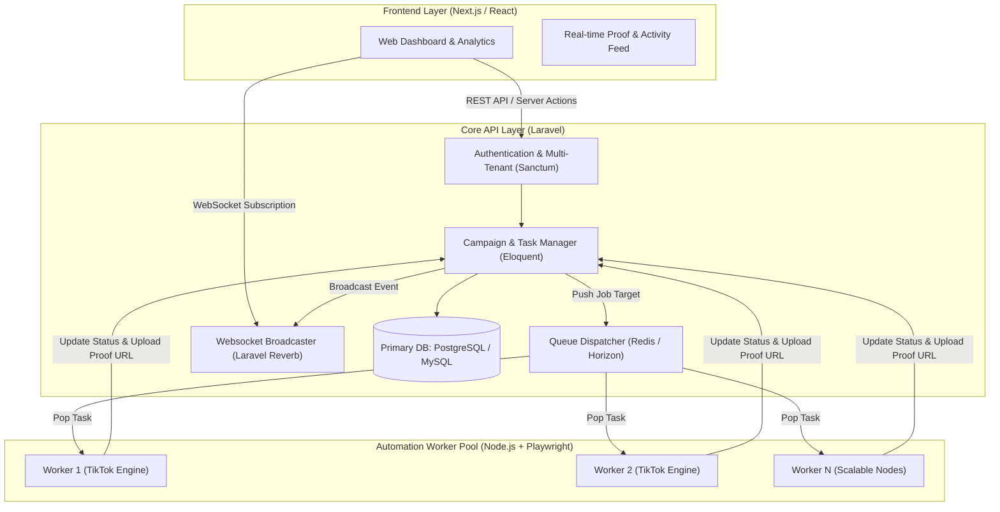
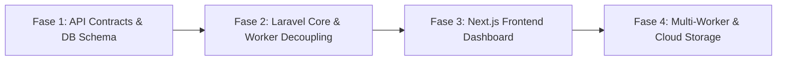

# 🚀 Scaleup Architecture & Roadmap Planning: OmniReach Platform

Dokumen ini merinci rencana transformasi arsitektur platform dari sistem monolitik lokal (*Express + SQLite + Vanilla JS*) menjadi arsitektur terdistribusi modern berbasis **Next.js/React**, **Laravel**, dan **Node.js Playwright Microservice**.

---

## 1. Motivasi & Tujuan Transformasi
1. **SaaS & Multi-Tenant Readiness:** Memungkinkan banyak pengguna/tim memiliki ruang kerja sendiri, multi-akun TikTok, dan paket langganan.
2. **Kestabilan Sistem (Isolation of Concerns):** Proses otomasi browser yang memakan RAM/CPU tinggi diisolasi dalam worker tersendiri sehingga web dashboard tidak akan pernah melambat atau crash.
3. **Horizontal Scalability:** Memungkinkan penambahan mesin worker (*multi-worker / multi-VPS*) untuk menjalankan ratusan outreach secara paralel.
4. **Modern UI/UX:** Dashboard berbasis React/Next.js dengan rendering cepat, komponen interaktif, dan visualisasi metrik real-time.

---

## 2. Gambaran Arsitektur Sistem (Decoupled Microservices)



---

## 3. Pembagian Tanggung Jawab Komponen

| Komponen | Teknologi | Peran & Tanggung Jawab Utama |
|---|---|---|
| **Frontend** | **Next.js (App Router), React, Tailwind CSS, Shadcn UI** | - Antarmuka modern, responsif, dan ramah pengguna.<br>- Form input kampanye, pemilih target, dan editor pesan template.<br>- Live feeds aktivitas, preview gambar bukti (*proof*), dan ringkasan metrik status (*sent, failed, dm_closed*). |
| **Core API & Business Logic** | **Laravel 11+, PostgreSQL/MySQL, Redis, Laravel Horizon** | - Otentikasi pengguna, otorisasi peran (*RBAC*), dan sistem kuota.<br>- Manajemen kampanye, target, kontak, dan riwayat pesan.<br>- Penjadwalan antrean job (*Queue*) terdistribusi berbasis Redis.<br>- Webhook/API endpoint untuk menerima laporan hasil dari worker.<br>- Pengiriman event real-time melalui Laravel Reverb / Pusher. |
| **Automation Engine** | **Node.js, Playwright, Stealth Plugins** | - Menjalankan browser terisolasi (*headful/headless*) secara stabil.<br>- Logika navigasi profil TikTok, interaksi tombol pesan, dan *anti-detection*.<br>- Pengetikan pesan satu balon (*single-bubble*) dan verifikasi keberadaan balon chat.<br>- Pengambilan tangkapan layar bukti (*screenshot proof*) dan pengunggahan ke Object Storage (S3 / MinIO). |

---

## 4. Mekanisme Komunikasi Antar-Layanan

### A. Pengiriman Tugas (Laravel ➡️ Node.js Worker)
- Laravel mendispatch payload tugas ke **Redis Queue**:
  ```json
  {
    "task_id": 101,
    "campaign_id": 12,
    "platform": "tiktok",
    "target_url": "https://www.tiktok.com/@shofi.zakaria",
    "username": "shofi.zakaria",
    "template": "Halo Kak! 👋...",
    "session_profile_key": "acc_slot_1"
  }
  ```

### B. Pelaporan Hasil Tugas (Node.js Worker ➡️ Laravel)
- Setelah selesai, Worker mengirim status ke REST API internal Laravel:
  ```json
  {
    "task_id": 101,
    "status": "sent", // sent | failed | dm_closed
    "proof_url": "https://storage.domain.com/proofs/proof_101_shofi.zakaria.png",
    "message_sent": "Halo Kak! 👋...",
    "error_detail": null,
    "completed_at": "2026-11-05T15:00:00Z"
  }
  ```
- Laravel menyimpan hasil ke database dan memancarkan event WebSocket ke dashboard pengguna.

---

## 5. Rencana Tahapan Migrasi (Roadmap)



### Fase 1: Desain Kontrak API & Skema Database
- Merancang tabel migrasi database di Laravel: `users`, `campaigns`, `outreach_tasks`, `proofs`, `tiktok_accounts`, `logs`.
- Menetapkan skema REST API dan format pesan antrean Redis.

### Fase 2: Pembangunan Core Laravel & Adaptasi Worker Node.js
- Membangun API Laravel untuk Create Campaign, Upload CSV Target, dan Queue Dispatcher.
- Menyesuaikan kode Node.js (`src/services/tiktok.service.js`) agar menjadi *consumer* antrean murni (menerima input via queue / HTTP payload, mengembalikan output ke endpoint Laravel).
- Memindahkan penyimpanan file screenshot dari folder lokal `proofs/` ke Cloud Object Storage (AWS S3, Cloudflare R2, atau Supabase Storage).

### Fase 3: Pembangunan Antarmuka Next.js
- Membangun dashboard analitik, halaman kampanye, dan penampil log real-time dengan React Query & WebSocket client.
- Mengintegrasikan antarmuka modal preview screenshot bukti interaktif.

### Fase 4: Pengujian Beban & Skalabilitas Multi-Worker
- Menjalankan 2–5 instance Node.js Playwright worker secara bersamaan untuk memproses antrean secara terdistribusi.
- Menyiapkan monitoring performa antrean menggunakan Laravel Horizon.

---

## 6. Ringkasan Keunggulan Setelah Scaleup
- **Zero Downtime UI:** Browser berat atau crash tidak akan pernah membuat dashboard web down.
- **Efisiensi Biaya VPS:** Worker Playwright dapat ditempatkan pada VPS hemat CPU/RAM tinggi, sedangkan API Laravel dan Next.js dapat di-host di server terpisah.
- **Komersialisasi Siap Pakai:** Struktur siap dijadikan produk komersial (*Software as a Service*) dengan sistem langganan per bulan.

